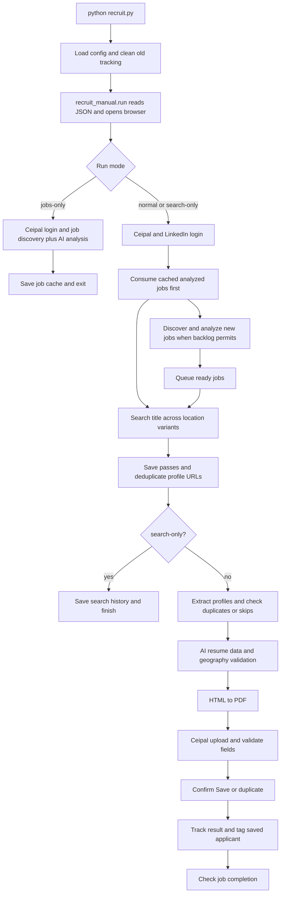

# Ceipal → LinkedIn → Resume → Ceipal

Ye project Ceipal ke Active/Open jobs read karta hai, AI se job details analyze
karta hai, LinkedIn Talent par matching profiles collect karta hai, resume PDF
banata hai, aur Ceipal applicant form mein upload, Save aur job tagging karta hai.

**Main entry point: `python recruit.py`.** Current behavior ke liye ye README
primary guide hai. `.docs/` ke older documents mein previous flow bhi described hai.

## Developer quick orientation

This guide uses simple Hinglish. Suggested code reading order:
`recruit.py` -> `recruit_manual.py` -> `recruiting_ai.py` -> `azure_title.py`.
Location issues ke liye `profile_location.py`; shared selectors ke liye `main.py` dekho.

### End-to-end flow



Producer (`produce_jobs`) discovery/analysis karta hai; consumer (`consume_jobs`
inside `run`) ready jobs process karta hai. Dono asyncio tasks hain. New analysis
aur LinkedIn processing overlap ho sakte hain; consumer one job at a time aur
candidate loop one profile at a time process karta hai. Selected blocking AI,
DB aur geography calls `asyncio.to_thread()` se run hote hain.

Browser tabs: Ceipal jobs, LinkedIn search, candidate profile, Ceipal applicant.
Saved session `browser-data-recruit/` mein rehti hai.

### Guide navigation

| Section | Purpose |
|---|---|
| 1 | Setup, run commands and CLI flags |
| 2 | Every application file, configuration and generated folder |
| 3-5 | Startup queue, job analysis, LinkedIn searches |
| 6-7 | Candidate extraction, PDF, applicant Save and tagging |
| 8 | JSON fields, statuses and restart behavior |
| 9-10 | Configuration and troubleshooting |
| 11-12 | Function map, example and where to change code |

## 1. Setup aur run

Prerequisites: Python with pip, Ceipal account, LinkedIn Talent access, MySQL
server/table, and configured Ollama or Azure. Python version repository mein pin
nahi hai. Geography lookup ko network chahiye.

Optional isolated environment, project folder ke PowerShell mein:

```powershell
python -m venv .venv
.\.venv\Scripts\Activate.ps1
```

Project folder ke terminal mein:

```powershell
python -m pip install -r requirements.txt
python -m playwright install chromium
```

`.env` mein credentials, MySQL connection aur AI provider set karo. Existing `.env`
ko overwrite mat karo. New setup ke liye `recruit.env.example` template hai;
database keys neeche diye hain, template mein manually add karne pad sakte hain.

```powershell
# Normal flow: cached pending jobs, searches, resumes, applicants, tagging
python recruit.py

# Sirf Ceipal jobs collect + AI analysis; LinkedIn/applicant processing nahi
python recruit.py --jobs-only

# New discovery ko 5 jobs tak limit karo
python recruit.py --jobs-only --jobs-limit 5

# Search/URL collection only; applicant upload/save nahi
python recruit.py --search-only --limit 3

# Ek specific Ceipal job
python recruit.py --job-url "https://talenthirecls12.ceipal.com/job_postings/job_snapshot/JOB_ID"
```

Normal run external Ceipal applicant records create/save karta hai.
Login/verification browser mein complete karna pad sakta hai.

Restart: normal run first uploads existing tracked pending PDFs before new
searches, profile extraction or job analysis. PDFs are reused without AI/extraction.
If upload fails, its generated PDF is deleted and `skipped_processing_failed` is recorded; the next profile continues. Tracked PDFs in `saving`/`review_required` are retried with existing DB/Ceipal duplicate checks. Jobs-only/search-only do not
upload PDFs. Pending PDF jobs are preserved by old-job cleanup.

| Flag | Meaning |
|---|---|
| `--jobs-only` | Job discovery aur analysis only |
| `--jobs-limit N` | New discovery ka limit; default all Active/Open jobs. Already analyzed startup queue ka limit nahi |
| `--limit N` | Har location variant se max profiles; 1–20, default 20. Merged unique list poori process hoti hai |
| `--search-only` | Search aur URLs store; profile extraction/resume/upload nahi |
| `--job-url URL` | Sirf specified job |
| `--location TEXT` | Search location override; job ka stored AI-final location automatically replace nahi karta |

### Continuous new-job checking

Normal `python recruit.py` now stays running. After queued jobs finish, it opens
the Ceipal job list afresh (pagination resets), discovers Active/Open jobs and
runs the same analysis/search/profile/upload/tag pipeline for new work. Completed
jobs are skipped using existing cache/history. If no new work is queued, it waits
10 minutes before checking again. Pending batches and discovery errors still retry
after 30 seconds. Browser/profile tabs are reused across passes. Stop with Ctrl+C.
`--jobs-only`, `--search-only`, and explicit `--job-url` remain finite runs.
## 2. Har file ka kaam

| File / folder | Role |
|---|---|
| `recruit.py` | Entry point, CLI, login/2FA, Ceipal discovery, title/location filters, LinkedIn pagination/URL collection, cleanup aur atomic JSON writes |
| `recruit_manual.py` | Main orchestration: queue producer/consumer, job analysis, profile processing, resume HTML/PDF, MySQL duplicate checks, Ceipal fields/Save/Quick Tag |
| `recruiting_ai.py` | Structured AI JSON extraction: job title/location/JD/skills/experience, profile/resume content, role-description source checking, city-name true/false |
| `azure_title.py` | Shared AI transport: `.env` provider se Azure ya Ollama. Title/location cleaning aur location-validation helpers bhi hain; filename ke bawajood Azure-only nahi |
| `profile_location.py` | `pycountry` se country/state names normalize; `geopy` se city/state/country match. `valid`, `invalid`, `unknown` results; serialized/cached lookups |
| `location_utils.py` | Location components se `N/A`, null, unknown, remote jaise non-geographic placeholders remove karta hai |
| `state_store.py` | JSON object reader. Missing/empty file → `{}`; malformed non-empty file preserve karke clear error |
| `profile_rules.py` | Rules-based profile section parsing, experience/education/skills extraction aur name/location helpers. Current pipeline isse supporting rules import karti hai |
| `main.py` | Shared Ceipal/LinkedIn selectors, constants, `.env` loader, dummy email/mobile. Iska standalone `main()` older harvesting flow hai |
| `url.py` | Separate older public-profile extraction tool. Main Talent pipeline isse AI profile extraction ke liye use nahi karti; iska provider handling alag hai |
| `requirements.txt` | Main pipeline dependencies: requests, Playwright, MySQL connector, geopy, pycountry |
| `.env` | Local credentials/settings; real values README/console/chat mein copy mat karo |
| `recruit.env.example` | Configuration template aur optional selector overrides |
| `extract_job.json` | Job cache, raw/AI-analyzed job data aur LinkedIn job progress |
| `job_history.json` | Per-job location passes, collected URLs, search/profile completion |
| `profile_data.json` | Minimal per-profile tracking aur final location/validation metadata |
| `resumes/` | Generated candidate resume PDFs |
| `browser-data-recruit/` | Persistent browser session; saved logins/cookies |
| `__pycache__/` | Python-generated cache |
| `.gitignore` | Browser state, generated JSON/PDFs aur Python cache ke ignore patterns |
| `harvesting.bat` | Older launcher: hardcoded `C:\Power_automate\robot-main` aur `python recruit_manual.py` use karta hai. Current run ke liye `python recruit.py` use karo |
| `.docs/README.md`, `.docs/README.docx` | Older documentation; some instructions previous implementation ki hain |
| `.docs/JD_AI_FLOW.md` | Incremental implementation notes; older statements may be superseded by later notes |

`recruit_manual.py` mein older/detailed/strict location helper functions preserve
kiye gaye hain. Current applicant flow `validate_parsed_location_before_save()`
call karta hai, `_strict`, `_legacy` ya `_detailed` versions nahi.

## 3. Startup aur business-unit queue

1. `.env` load hoti hai; JSON state read hota hai.
2. Older-than-three-days job cleanup run hota hai. Analyzed-but-LinkedIn-incomplete
   jobs ko cleanup preserve karta hai; other old jobs aur linked state remove ho sakte hain.
3. `analysis_status="completed"` aur LinkedIn incomplete jobs startup queue mein
   aate hain. In jobs ki AI analysis dobara nahi hoti, analysis version badalne par bhi nahi.
4. Browser opens; Ceipal aur LinkedIn login ready hone ke baad consumer start hota hai.
5. Existing analyzed queue pehle clear hoti hai. Har job ke baad history check hoti hai.
6. Koi analyzed job incomplete rahe to new discovery defer hoti hai; job pending rahti hai.
7. Backlog complete hone par new jobs discover/analyze hote hain. Har newly analyzed
   job ready hote hi queue mein aati hai; remaining analysis background mein chal sakti hai.

| Priority index | Business unit |
|---|---|
| 1 | Federal |
| 2 | SLED |
| 3 | Canada |
| 4 | Healthcare |
| 5 | IT |
| 6 | Commercial |
| 7 | Non-IT |

Priority `JOB_INDEX_PRIORITY`, `normalize_job_index()` aur `job_sort_key()` mein
defined hai. Unknown unit currently Commercial normalize hoti hai.
Queued/available jobs priority mein sort hote hain; currently processing job interrupt nahi hoti.

## 4. Ceipal job extraction aur AI analysis

Main functions: `discover_jobs()` → `produce_jobs()` → `enrich_job_details()`.

1. Ceipal list ke Active/Open rows se code, title, listed location, business unit
   aur posted date read hote hain; list pagination follow hoti hai.
2. Job detail page one by one open hota hai. Configured title selector ya labeled
   title read hota hai; unavailable ho to listed title fallback hota hai.
3. Raw title/location print hote hain. Original Format link
   `a.cpjDS.show_all_desc` visible ho to click hota hai; hidden ho to full JD read ki jaati hai.
4. Full JD `.jd_expand_div_data` ya `#descmore` se read hoti hai; truncated
   `#descless` use nahi hota. `CEIPAL_JOB_DESCRIPTION_SELECTOR` override available hai.
5. `raw_title`, `raw_location`, `raw_jd` AI call se pehle print/save hote hain.
6. AI cleaned title, city/state/country, available JD, maximum 7 supported skills
   aur required experience return karta hai. Skills ke liye target 5–7 hai, source
   mein fewer skills hon to fewer hi return hoti hain.
7. JD absent ho to title/location analyze hote hain; `skills`, `experience`,
   `job_description` JSON `null` hote hain. Title se skills/experience guess nahi hote.
8. Country required hai. AI country resolve na kar sake to analysis complete nahi hoti.
9. `ai_final_location` aur `location_variants` save hote hain; successful analysis
   `analysis_status="completed"` mark hoti hai. AI failure par raw data retained rahta hai.

Full location available ho to variants:

```json
[
  "Fredericton, New Brunswick, Canada",
  "New Brunswick, Canada",
  "Canada"
]
```

Sirf country available ho to `['Canada']` ke equivalent JSON list use hoti hai.
`N/A` search variant nahi banta. Missing city/state invent nahi hote.

## 5. LinkedIn search: pehle saare variants, phir profiles

Main function: `process_job()`.

1. Cleaned job title aur full location variant apply hote hain.
2. URLs collect karke pass history save hoti hai.
3. State/country variant par search aur URLs save hote hain.
4. Country variant par search aur URLs save hote hain.
5. All collected URLs merge/deduplicate hote hain.
6. Final unique list `process_candidate_profiles()` ko milti hai.

Saved pass URLs restart par reuse hote hain; remaining location searches pehle
finish hote hain. `--limit 3` ka matlab har variant se up to 3 profiles; combined
list mein duplicate removal ke baad up to 9 profiles ho sakte hain.

## 6. Profile extraction, duplicate checks aur resume

1. Cached public URL ho to profile kholne se pehle MySQL duplicate check.
2. Talent profile ke initial visible content se location aur public URL read hote hain.
3. India location detected ho to full extraction, AI, PDF aur upload skip.
4. Public URL same job ke liye DB mein ho to `skipped_db_exists`; disclosures,
   full extraction aur PDF avoid hote hain when the URL is found early.
5. Public URL later mile to AI/PDF se pehle another DB check; upload se pehle
   final defensive duplicate check bhi hai. Duplicate check is `(public_url, job_code)`.
6. Non-skipped profiles ke disclosures expand, profile text/skills/certifications extract hote hain.
7. AI names, job title, location, professional summary, experience, education,
   skills aur certifications structure karta hai.
8. Har role ki description usi role ke verbatim `source_description` se supported
   honi chahiye. AI wording professionally refine kar sakta hai; new duties,
   achievements, numbers ya another role ki description add nahi honi chahiye.
   Source role match na ho to description blank rahti hai.
9. Professional summary source facts se 3–5 sentences target karti hai;
   limited evidence par shorter summary allowed hai.
10. **PDF se pehle geography validation**: valid city/state/country match → canonical
    profile fields. Invalid/unknown/unavailable lookup → **AI-final job location** fallback.
    Raw listed job location fallback ke liye use nahi hoti.
11. Final `location`, `city`, `state`, `country` profile mein map hote hain;
    HTML escaped hota hai aur Playwright PDF banata hai. New AI profile content
    ke liye fresh PDF render hoti hai.

Raw profile text, extracted AI data aur final resume profile console mein print
hote hain; full profile content JSON mein persist nahi hota. In-memory content
resume banane ke liye use hota hai. PDF mein candidate data naturally included hai.

## 7. Ceipal upload → fields → validation → Save → tag

Main functions: `create_applicant()`, `ensure_applicant_field()`,
`validate_parsed_location_before_save()`, `quick_tag_job()`.

1. Add Applicant page opens; resume upload control mein PDF select hoti hai.
2. Upload confirmation visible ho to accept hoti hai.
3. Editable form ke liye wrapper selector **ya visible First/Last Name controls**
   detect hote hain. Name fields already populated hona required nahi.
4. Duplicate modal ho to existing-applicant result record hota hai.
5. Parsed names unchanged rehte hain. Blank email/mobile ko dummy values fill karte hain; existing parsed contact values preserve hote hain.
6. Source configured label par set hota hai.
7. City/state geography validation PDF banne se pehle hoti hai (section 6).
8. Save se pehle visible Country and State/Province dropdowns label/name se detect
   hote hain. Canada business-unit job par country Canada confirm/set hota hai.
   Parsed city + selected state/country validate hote hain; invalid location par
   available resume/profile/job city-state candidates try hote hain. Matching
   State/Province dropdown select hota hai, city fill hoti hai, then actual form
   city/state/country AI se dobara check hote hain. Failure par Save nahi hoti aur
   failure is recorded, generated PDF is deleted, and the next profile continues. First/Last Name checks nahi hote; blank email/mobile dummy values se fill hote hain.
9. Save click ke baad applicant snapshot URL ya duplicate response verify hota hai.
10. Save confirmed ho to DB tracking update aur Quick Tag mein job code tag hota hai.
    Tag failure separately record hoti hai; saved applicant automatically undo nahi hota.

Per-profile errors do not terminate the run. Failed attempts become `skipped_processing_failed`; their local PDF is deleted and the next profile proceeds. Successful Save/duplicate paths also clean up local PDFs. A confirmed saved record remains saved if a later tracking operation fails.

## 8. JSON files aur statuses

### `extract_job.json` — job code se keyed

Important fields: `code`, `url`, `title`, `cleaned_title`, `business_unit`,
`job_index`, `raw_title`, `raw_location`, `raw_jd`, `jd`, `job_description`,
`skills`, `experience`, `city`, `state`, `country`, `location`, `ai_final_location`,
`location_details`, `location_variants`, `analysis_status`, `analysis_error`,
`linkedin_processing`.

| Field | Values / meaning |
|---|---|
| `analysis_status` | `pending` → `completed`, or `failed` |
| `linkedin_processing` | `pending` → `processing` → `completed`; incomplete work returns to `pending` |
| `job_analysis_version` | Metadata only; completed analysis is reused automatically |

### `job_history.json` — search aur job progress

Stores job details, `location_search_variants`, `location_searches` and merged
`profiles`. Each pass has `pass`, `location`, `profiles`, `search_status`, `status`.
URLs collected hone par pass `collected`; candidate work incomplete ho to
`processing`; all final profiles ho to `completed`.

Job `status=completed` tab hoti hai jab all location passes complete aur all
collected profiles final statuses mein hon. Zero profiles par job pending rahti hai.
Completion mein deliberate skips bhi count hote hain; har URL ka saved applicant
hona required nahi. Job tagging success completion check ka separate gate nahi hai.

### `profile_data.json` — Talent URL se keyed

Persists URL/public URL, status, job codes, extraction version, PDF path,
applicant URL, tag status, final location fields, location source,
`location_validation`, `city_location_validated`, and error metadata.
Raw text/full experience/education/skills profiles disk JSON mein save nahi hote.

| Profile status | Meaning |
|---|---|
| `pending`, `extracted` | Work in progress |
| `saving` | Save requested; outcome not confirmed yet |
| `saved` | Applicant snapshot confirmed |
| `duplicate` | Ceipal duplicate response |
| `skipped_db_exists` | Public URL/job already in DB |
| `skipped_india_location` | India location; extraction/upload skipped |
| `skipped_linkedin_member` | Anonymous LinkedIn Member skipped |
| `failed` | Older retryable failure; tracked PDF is attempted first on restart |
| `skipped_processing_failed` | Attempt failed; local PDF cleanup attempted, error retained, next profile continues; counts as final skip |
| `review_required` | Uncertain Save or form action needs manual reconciliation |

Older `form_ready` and `skipped_resume_parser_failed` remain recognized terminal
statuses for compatibility. Old wrongly skipped/DB-completed records are **not**
automatically reset by the current code. Reconcile the actual Ceipal applicant
before changing tracking or retrying to avoid duplicates.

`saving` becomes `review_required` at startup; when a tracked PDF exists, startup retries its upload before new processing. Existing DB/Ceipal duplicate checks remain. Failures are skipped with error tracking and local PDF cleanup; the queue continues.

## 9. Configuration

```dotenv
# Choose ONE; restart Python after editing.
AI_PROVIDER=ollama
OLLAMA_MODEL=qwen2.5:3b
OLLAMA_URL=http://localhost:11434/api/chat

# For Azure instead:
# AI_PROVIDER=azure_ai
AZURE_AI_ENDPOINT=
AZURE_AI_API_KEY=

DB_HOST=localhost
DB_PORT=3306
DB_USER=your_database_user
DB_PASSWORD=your_database_password
DB_NAME=your_database_name
DB_PROFILE_URL=linkedin_havesting_url

GEOCODER_DOMAIN=nominatim.openstreetmap.org
```

Azure endpoint must be the full deployment chat-completions URL including
`api-version`. `AI_PROVIDER=azure_ai/Olama` is invalid: choose one provider.
Main pipeline accepts `ollama`/`olama` and `azure_ai`/`azure`; `openai`, `none`
and `auto` belong to older standalone tooling, not this pipeline's AI transport.

Local model setup:

```powershell
ollama pull qwen2.5:3b
ollama list
# If local server isn't running:
ollama serve
```

Other settings:

| Keys | Purpose |
|---|---|
| `LINKEDIN_EMAIL`, `LINKEDIN_PASSWORD` | Talent login |
| `Linkedin_tanlent`, `LINKEDIN_TALENT_URL` | Talent start URL; original spelling retained |
| `Code` | Optional authenticator secret for local TOTP |
| `CEIPAL_EMAIL`, `CEIPAL_PASSWORD` | Ceipal login |
| `CEIPAL_SIGNIN_URL`, `CEIPAL_ADD_APPLICANT_URL` | Ceipal endpoints |
| `CEIPAL_SOURCE` | Applicant source label |
| `CEIPAL_JOB_*_SELECTOR` | List/title/location/JD selector overrides |
| `LINKEDIN_*_SELECTOR` | Search title/location/results/pagination/profile overrides |
| `CEIPAL_PARSE_RESUME_SELECTOR`, `CEIPAL_PARSE_SAVE_SELECTOR` | Upload and Save controls |
| `OLLAMA_CONTEXT_LENGTH` | Local model context length; default in AI client is 16384 |

The main MySQL table must contain `id`, `url`, `job_code`, `business_unit`,
`status`, `job_status`, `job_title`, `cleaned_job_title`, `date_posted`.
Current pipeline does not create this table automatically. `DB_TABLE` is for the
older `main.py` queue, while the active flow uses `DB_PROFILE_URL`.

## 10. Common errors aur real-flow checks

| Symptom | Action / behavior |
|---|---|
| `No module named requests/mysql/geopy/pycountry` | `python -m pip install -r requirements.txt`; MySQL package name is `mysql-connector-python` |
| Browser executable missing | `python -m playwright install chromium` |
| Ollama connection error | Start Ollama; verify model with `ollama list` |
| Azure `403 Forbidden` | Check resource key, full endpoint, access and network configuration; raw job extraction remains saved |
| Empty JSON | Reader treats it as `{}`; previous tracking is not recoverable from an empty file |
| Malformed non-empty JSON | File preserved; fix reported line/column |
| Form visible but timeout | Check selectors/field names; no automatic parser-failed completion or PDF deletion |
| Geography lookup slow/unavailable | `unknown` result uses AI-final job location; geocoder needs network |
| New discovery does not start | Check analyzed pending jobs and `review_required` profiles; backlog must finish first |

Console logs show job/unit priority, raw job data, AI output, collected URLs,
profile extraction, geography result/fallback, PDF, DB check, upload, required
fields, pre-save checks, Save confirmation and tagging. Logs include candidate
data, so handle captured terminal output accordingly.

Current workspace mein automated test suite present nahi hai. Use `--jobs-only --jobs-limit 1`
and `--search-only --limit 3` for limited checks, then a deliberately limited
real applicant run. End-to-end selectors and Save/tagging still require a live session.

## 11. Function-wise code navigation

### `recruit.py` - CLI and browser/search utilities

| Functions | Kya ho raha hai |
|---|---|
| `main()` | CLI parse -> old-state cleanup -> `recruit_manual.run()` |
| `login()`, `linkedin_2fa()`, `wait_for_sites_ready()` | Login, optional TOTP, session readiness |
| `discover_jobs()`, `go_to_next_ceipal_job_page()` | Active/Open job rows and pagination; metadata in `JOB_METADATA` |
| `apply_title()`, `apply_location()`, `clear_existing_location_filters()` | LinkedIn search controls |
| `generate_location_variants()` | Full location se broader state/country searches |
| `collect_profiles()`, `collect_page_profiles()`, `go_to_next_results_page()` | Scrolling, pagination, unique profile URLs and limit |
| `cleanup_old_job_data()`, `save_state()` | Three-day retention and temporary-file replacement for JSON writes |

`main()` current module ko `api` argument banakar orchestration ko pass karta hai.
Isliye `recruit_manual.py` mein `api.login()` ka actual implementation `recruit.py`
mein hai. Importing shared `main.py` loads `.env` through `load_env()`.

### `recruit_manual.py` - business workflow

| Functions | Kya ho raha hai |
|---|---|
| `run()` | Read JSON, normalize startup state, open browser, start producer/consumer, close browser |
| `produce_jobs()` | Cached analyzed backlog first; then discover, enrich and queue jobs |
| `normalize_job_index()`, `job_sort_key()` | Business-unit priority mapping |
| `read_original_job_description()` | Expanded original/full JD extraction |
| `enrich_job_details()` | Persist raw job -> AI analysis -> final location and analyzed cache |
| `process_job()` | Search passes -> merged URLs -> candidate processing -> job completion |
| `read_profile_text()`, `extract_profile()` | Read profile, early skip checks, expand disclosures and extract data |
| `process_candidate_profiles()` | Per-profile checks, AI, geography, PDF, applicant processing and errors |
| `ensure_profile_location()`, `is_currently_in_india()` | Location backfill and India exclusion |
| `render_resume_html()`, `resume_*` helpers, `RESUME_CSS` | Resume sections, escaping and layout |
| `write_resume_pdf()` | Chromium renders HTML into `resumes/` PDF |
| `create_applicant()` | Upload, parsed form, required fields, Save confirmation, tracking, tagging |
| `ensure_applicant_field()` | Preserve parsed value; fill fallback if blank |
| `validate_parsed_location_before_save()` | Active country/state/city validation |
| `quick_tag_job()` and related helpers | Open Quick Tag, select job code, save tag |
| `linkedin_public_url_exists()` | MySQL duplicate lookup for public URL/job |
| `update_linkedin_havesting_status()` | Insert/update candidate tracking |
| `update_job_processing_status()` | DB job-level completion update |
| `read_store()`, `save_state_json()`, nested `persist()` | JSON read/write and candidate tracking allowlist |

This file defines functions and has no standalone CLI entry point. Running
`python recruit_manual.py` directly does not start the pipeline. The older
`harvesting.bat` currently calls that file and uses another hardcoded directory.

### AI, geography and parsing files

| File | Important functions and data flow |
|---|---|
| `recruiting_ai.py` | `extract_json()` sends instructions/source and parses AI JSON. `analyze_job()` structures job data. `build_ai_resume_profile()` structures resume content; `_retain_role_descriptions()` checks source support. `validate_city_name()` checks city-name plausibility. |
| `azure_title.py` | `_post_with_retry()` routes provider; `_post_azure()` calls Azure, `_post_ollama()` adapts Ollama into common response shape. `_extract_message_content()` reads text. `clean_job_title()`, `clean_job_location()`, `validate_city_location()` provide focused helpers. Timeout: 500 seconds/request; selected retryable HTTP errors: up to three attempts with five-second delay. |
| `profile_location.py` | `_country()` and `_state()` normalize names; `_lookup()` performs cached/serialized Nominatim requests; `validate_profile_location()` returns valid/invalid/unknown geography metadata. |
| `location_utils.py` | `clean_location_parts()` filters placeholders; `clean_location()` joins usable components. |
| `state_store.py` | `read_json_object()` loads UTF-8/BOM JSON, allows absent/empty files, rejects malformed data and non-object roots. |
| `profile_rules.py` | `extract_sections()`, `parse_experience()`, `parse_education()`, `parse_certifications()`, `build_profile()` provide rules parsing. Main flow imports name-validation helpers; active resume structuring uses `recruiting_ai.py`. |

### Shared, standalone and support files

- `main.py`: shared constants/selectors, `load_env()`, dummy contact helpers.
  Its own `main()` runs an older synchronous workflow: DB pending public URLs ->
  profile -> PDF -> Ceipal. `db_ensure_table()` provisions that older queue table,
  not the active pipeline's `DB_PROFILE_URL` table.
- `url.py`: separate public-profile CLI. `fetch_profile()` reads public profiles,
  `build_skill_set()` structures skills, `save_json()` writes outputs. Defaults:
  `public_profile.json`, `skill_set.json`. `--input` reuses saved input;
  `--headed` shows its browser. Provider handling differs from active pipeline.
- `requirements.txt`: third-party dependencies; local Python files use imports.
- `recruit.env.example`: starter config. Its OpenAI suggestion belongs to older
  tooling; active pipeline transport supports Ollama/Azure only.
- `.env`: local credentials/settings. For a new installation only, copy template
  with `Copy-Item recruit.env.example .env`, then fill values and add DB keys.
  Existing process environment wins over `.env` because loader uses `setdefault()`.
- `.gitignore`: generated JSON, PDFs, browser session and bytecode patterns.
  Current file does not include `.env` or `.venv/`, despite the template's claim
  that `.env` is ignored. Check exclusions before committing local configuration.
- `extract_job.json`, `job_history.json`, `profile_data.json`: runtime tracking,
  schemas/statuses in section 8. These are not configuration templates.
- `resumes/`: generated PDF files, which successful/duplicate paths may delete.
- `browser-data-recruit/`: Chromium-owned cookies, login session and caches;
  internal files are browser storage, not individual application modules.
- `__pycache__/`: Python-generated bytecode.
- `.docs/README.md`, `.docs/README.docx`, `.docs/JD_AI_FLOW.md`: historical docs;
  use current implementation and this README for active behavior.

## 12. One-job example aur debugging map

Illustrative example, actual candidate/job data nahi:

1. Ceipal job `JOB-123`, title `Senior Python Developer`, location
   `Fredericton, New Brunswick, Canada` discover hota hai.
2. Raw fields job cache mein save hote hain. AI cleaned title, skills, experience
   aur final city/state/country return karta hai.
3. LinkedIn full location, province/country, country par search karta hai.
   `--limit 3` each pass par up to three URLs collect karta hai.
4. Three passes se nine URL occurrences aaye aur two repeats hon to seven unique
   profiles process honge. All searches finish hone ke baad candidate loop starts.
5. Har candidate ke duplicate/skip checks, AI extraction, geography validation,
   resume HTML/PDF aur Ceipal upload/Save/tagging steps run hote hain.
6. Final statuses se job completion decide hoti hai. Resume failure ya uncertain
   Save ho to pending/review state inspect karna hoga.
7. Restart par analyzed cache aur collected passes reuse hote hain. Uncertain Save
   retry se pehle actual Ceipal record check karo.

| Change / symptom | Start here | Evidence |
|---|---|---|
| Wrong jobs or missing list page | `recruit.discover_jobs()` | Row/status selectors and job metadata |
| Wrong raw title/JD/location | `enrich_job_details()`, `read_original_job_description()` | `raw_*` in job cache |
| Correct input, wrong AI result | `recruiting_ai.py`, `azure_title.py` | Raw versus AI output, provider/model config |
| Wrong searches/few URLs | `process_job()` and `recruit.py` search helpers | Location passes in `job_history.json` |
| Missing experience/education | `extract_profile()`, `build_ai_resume_profile()` | Raw versus extracted profile console logs |
| PDF layout issue | `render_resume_html()`, `RESUME_CSS` | Generated PDF |
| PDF location issue | `validate_profile_location()`, candidate loop | `location_source`, `location_validation` |
| Upload/form/Save failure | `create_applicant()` | Visible controls, status/error, retained PDF |
| Saved applicant missing tag | `quick_tag_job()` | `applicant_url`, `tag_job_status` |
| New discovery blocked | `produce_jobs()` | Analyzed backlog and uncertain profiles |
| Database error | DB helpers in `recruit_manual.py` | Config keys and actual table columns |

Onboarding checks:

```powershell
python recruit.py --help
python recruit.py --jobs-only --jobs-limit 1
python recruit.py --search-only --limit 3 --job-url "https://talenthirecls12.ceipal.com/job_postings/job_snapshot/JOB_ID"
```

Replace `JOB_ID` with a real accessible job. Jobs-only calls AI, even though its
CLI help has an older description. Both limited modes write local state, and
startup cleanup applies to all modes. Normal mode saves real Ceipal applicants.
`--jobs-limit` does not cap cached backlog; use `--job-url` for a specific job.